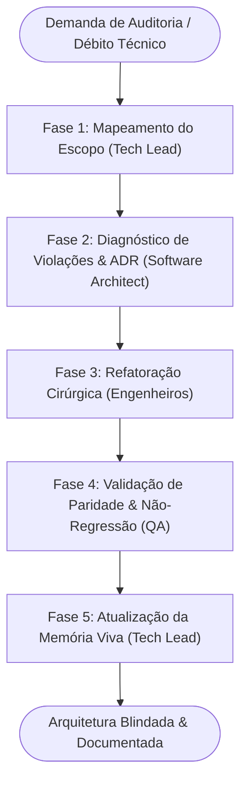

# 🏛️ Workflow: Auditoria Arquitetural & Refatoração (Architecture Review)

> **Identificador:** `architecture-review.md`  
> **Objetivo:** Auditar módulos do sistema para erradicar dívidas técnicas, identificar acoplamentos impróprios, garantir a separação pura de camadas e elevar a manutenibilidade do código.

---

## Visão Geral do Fluxo

---

## Pilares da Auditoria no BeatSync

1. **Pureza das Camadas:**
   - Telas e componentes em `src/screens/` e `src/components/` nunca devem interagir diretamente com APIs de baixo nível do `AsyncStorage` ou instâncias brutas de `AudioContext`.
   - Toda comunicação com persistência deve transitar exclusivamente por métodos exportados em `src/storage/storage.ts`.
   - Toda manipulação sonora deve ocorrer via `src/audio/audioEngine.ts`.
2. **Integridade de Contratos:**
   - Todos os tipos de dados compartilhados devem residir em `src/types/index.ts`.
   - Ausência absoluta de `any`, casts inseguros ou tipos redundantes espalhados pelos componentes.
3. **Prevenção de Gargalos de Renderização:**
   - Detecção de funções recriadas a cada batida do metrônomo que possam provocar engasgos na animação do pêndulo ou no visualizador.

---

## Detalhamento das Fases

### Fase 1: Mapeamento do Escopo
- **Agente Responsável:** [01-tech-lead-orchestrator.md](file:///d:/CASSIO/git/beatsync/.agents/personas/01-tech-lead-orchestrator.md)
- **Ações:**
  1. Delimita os arquivos ou pastas sujeitos à revisão.
  2. Cria a branch correspondente no padrão Conventional Branch (ex: `refactor/storage-repository-decoupling` ou `refactor/audio-engine-cleanup`).
- **Handoff Gate para Fase 2:** Módulos-alvo e escopo da auditoria fixados.

---

### Fase 2: Diagnóstico Arquitetural & Desenho
- **Agente Responsável:** [03-software-architect.md](file:///d:/CASSIO/git/beatsync/.agents/personas/03-software-architect.md)
- **Ações:**
  1. Inspeciona as dependências e o fluxo de dados entre os módulos selecionados.
  2. Lista as violações identificadas (acoplamentos indevidos, duplicação de lógica, vazamento de abstração).
  3. Se a refatoração alterar padrões globais, produz uma ADR (Architecture Decision Record) detalhando o estado anterior, a nova estrutura e os ganhos obtidos.
- **Handoff Gate para Fase 3:** Plano de refatoração passo a passo aprovado pelo Tech Lead.

---

### Fase 3: Refatoração Estruturada
- **Agentes Responsáveis:** [04-backend-engineer.md](file:///d:/CASSIO/git/beatsync/.agents/personas/04-backend-engineer.md) / [05-frontend-engineer.md](file:///d:/CASSIO/git/beatsync/.agents/personas/05-frontend-engineer.md)
- **Ações:**
  1. Executam a reestruturação em passos pequenos e incrementais.
  2. Preservam integralmente as assinaturas públicas consumidas por outras partes do app, ou atualizam todos os consumidores de forma consistente.
  3. Garantem compilação limpa (`npx tsc --noEmit`) a cada etapa.
- **Handoff Gate para Fase 4:** Código refatorado sem quebra de compilação ou alertas do linter.

---

### Fase 4: Validação de Paridade Funcional
- **Agente Responsável:** [06-qa-security-engineer.md](file:///d:/CASSIO/git/beatsync/.agents/personas/06-qa-security-engineer.md)
- **Ações:**
  1. Valida que o comportamento do app para o usuário final permanece 100% idêntico (paridade funcional).
  2. Testa exaustivamente a persistência dos dados salvos para garantir que esquemas antigos não foram invalidados.
- **Handoff Gate para Fase 5:** Relatório do QA confirmando zero regressão.

---

### Fase 5: Atualização da Memória Viva
- **Agente Responsável:** [01-tech-lead-orchestrator.md](file:///d:/CASSIO/git/beatsync/.agents/personas/01-tech-lead-orchestrator.md)
- **Ações:**
  1. Atualiza a seção de arquitetura e decisões no [PROJECT_CONTEXT.md](file:///d:/CASSIO/git/beatsync/.agents/PROJECT_CONTEXT.md).
  2. Remove débitos técnicos quitados da lista de pendências.
  3. Finaliza a branch.
