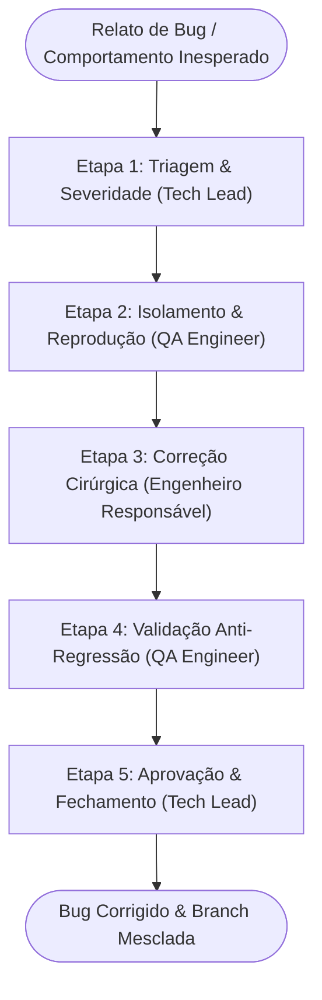

# 🐛 Workflow: Triagem & Correção de Bugs (Bugfix Triage)

> **Identificador:** `bugfix-triage.md`  
> **Objetivo:** Investigar a causa raiz de anomalias, isolar e reproduzir o erro deterministamente, aplicar correção cirúrgica e blindar o sistema contra regressões.

---

## Visão Geral do Fluxo

---

## Matriz de Severidade

| Severidade | Critério | Ação Imediata |
| :---: | :--- | :--- |
| **P0 - Bloqueador** | Crash do app, travamento irreversível do áudio, corrupção total do AsyncStorage. | Interrupção imediata de outras tarefas; hotfix prioritário. |
| **P1 - Alta** | Cálculo incorreto de BPM, falha ao salvar músicas/setlists, perda de estado transitório. | Correção na sprint/ciclo corrente com prioridade. |
| **P2 - Média/Baixa** | Falha cosmética, espaçamento incorreto, texto truncado sem impacto de uso. | Priorizado no fluxo regular de correções. |

---

## Detalhamento das Etapas

### Etapa 1: Triagem & Abertura de Branch
- **Agente Responsável:** [01-tech-lead-orchestrator.md](file:///d:/CASSIO/git/beatsync/.agents/personas/01-tech-lead-orchestrator.md)
- **Ações:**
  1. Identifica a camada suspeita (`audio`, `storage`, `screens`, `components`).
  2. Determina a severidade (P0/P1/P2).
  3. Cria a branch correspondente no padrão Conventional Branch (ex: `fix/audio-drift-high-bpm` ou `fix/storage-corrupt-json-fallback`).

---

### Etapa 2: Isolamento & Reprodução
- **Agente Responsável:** [06-qa-security-engineer.md](file:///d:/CASSIO/git/beatsync/.agents/personas/06-qa-security-engineer.md)
- **Ações:**
  1. Cria um roteiro de passos mínimos para reproduzir o bug deterministamente (*Minimal Reproducible Steps*).
  2. Registra os valores de entrada que provocam a anomalia (ex: compasso 7/8 com subdivisão tercina em 300 BPM).
  3. Isola se a causa é de lógica de estado, concorrência ou renderização.
- **Handoff Gate para Etapa 3:** Passos de reprodução confirmados e repassados ao desenvolvedor.

---

### Etapa 3: Correção Cirúrgica
- **Agente Responsável:** [04-backend-engineer.md](file:///d:/CASSIO/git/beatsync/.agents/personas/04-backend-engineer.md) ou [05-frontend-engineer.md](file:///d:/CASSIO/git/beatsync/.agents/personas/05-frontend-engineer.md)
- **Ações:**
  1. Localiza a condição faltante ou variável mal inicializada.
  2. Aplica alteração cirúrgica no código: **apenas as linhas estritamente necessárias para sanar a causa raiz**.
  3. Aplica *guard clause* preventiva no ponto de entrada da função para garantir que o estado anômalo não volte a ocorrer.
  4. Remove quaisquer logs de depuração gerados durante a investigação.
- **Handoff Gate para Etapa 4:** Código alterado e compilando sem erros (`npx tsc --noEmit`).

---

### Etapa 4: Validação Anti-Regressão
- **Agente Responsável:** [06-qa-security-engineer.md](file:///d:/CASSIO/git/beatsync/.agents/personas/06-qa-security-engineer.md)
- **Ações:**
  1. Executa o roteiro de reprodução da Etapa 2 e atesta que a falha desapareceu.
  2. Executa testes exploratórios nos módulos vizinhos para garantir que a correção não gerou efeitos colaterais colaterais.
- **Handoff Gate para Etapa 5:** Parecer formal do QA aprovando a eficácia da correção.

---

### Etapa 5: Aprovação & Fechamento
- **Agente Responsável:** [01-tech-lead-orchestrator.md](file:///d:/CASSIO/git/beatsync/.agents/personas/01-tech-lead-orchestrator.md)
- **Ações:**
  1. Audita o diff para certificar que nenhum código supérfluo foi introduzido.
  2. Valida se o aprendizado gerado deve ser incorporado no [PROJECT_CONTEXT.md](file:///d:/CASSIO/git/beatsync/.agents/PROJECT_CONTEXT.md) (ex: nova regra defensiva).
  3. Prepara o merge e informa a resolução ao usuário.
