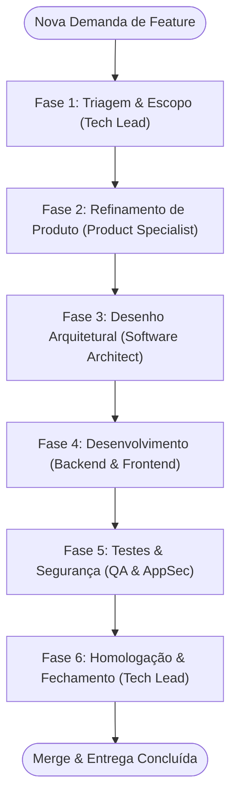

# 🔄 Workflow: Ciclo Completo de Novas Funcionalidades (Feature Lifecycle)

> **Identificador:** `feature-lifecycle.md`  
> **Objetivo:** Orquestrar o ciclo end-to-end de concepção, design, codificação, garantia de qualidade e entrega de uma nova funcionalidade no BeatSync.

---

## Visão Geral do Fluxo

---

## Detalhamento das Fases

### Fase 1: Triagem & Escopo
- **Agente Responsável:** [01-tech-lead-orchestrator.md](file:///d:/CASSIO/git/beatsync/.agents/personas/01-tech-lead-orchestrator.md)
- **Ações:**
  1. Analisa a viabilidade e alinhamento com a arquitetura do BeatSync.
  2. Define o nome da branch seguindo o padrão Conventional Branch (ex: `feat/audio-custom-subdivisions` ou `feat/songs-tagging-filter`).
  3. Cria o checklist inicial de entrega.
- **Handoff Gate para Fase 2:** Escopo delimitado, branch definida e sem ambiguidades impeditivas.

---

### Fase 2: Refinamento Funcional
- **Agente Responsável:** [02-product-specialist.md](file:///d:/CASSIO/git/beatsync/.agents/personas/02-product-specialist.md)
- **Ações:**
  1. Cria User Story com foco nas dores de músicos e performance ao vivo.
  2. Escreve critérios de aceite em formato BDD (Dado / Quando / Então).
  3. Mapeia comportamentos limítrofes (edge cases, listas vazias, inputs máximos).
- **Handoff Gate para Fase 3:** Critérios de aceite mensuráveis e validados com o usuário/Tech Lead.

---

### Fase 3: Desenho Técnico & Contratos
- **Agente Responsável:** [03-software-architect.md](file:///d:/CASSIO/git/beatsync/.agents/personas/03-software-architect.md)
- **Ações:**
  1. Projeta os contratos e interfaces TypeScript necessários em `src/types/`.
  2. Garante que regras de áudio fiquem encapsuladas em `src/audio/` e persistência em `src/storage/`.
  3. Se houver nova biblioteca externa ou decisão estrutural, redige uma ADR enxuta.
- **Handoff Gate para Fase 4:** Contratos de tipos aprovados sem acoplamento indevido.

---

### Fase 4: Implementação Especializada
- **Agentes Responsáveis:**
  - [04-backend-engineer.md](file:///d:/CASSIO/git/beatsync/.agents/personas/04-backend-engineer.md) (lógica de áudio, temporização, métodos do `storage.ts`)
  - [05-frontend-engineer.md](file:///d:/CASSIO/git/beatsync/.agents/personas/05-frontend-engineer.md) (componentes em `src/components/`, telas em `src/screens/`, layout móvel e haptic feedback)
- **Ações:**
  1. Escrevem código cirúrgico respeitando imutabilidade, early returns e zero uso de `any`.
  2. Implementam tratamento de erros resiliente (sem blocos catch vazios).
  3. Garantem cleanups de timers e listeners.
- **Handoff Gate para Fase 5:** Código compilando sem erros (`npx tsc --noEmit`) e sem console logs de depuração.

---

### Fase 5: Auditoria de QA & Segurança
- **Agente Responsável:** [06-qa-security-engineer.md](file:///d:/CASSIO/git/beatsync/.agents/personas/06-qa-security-engineer.md)
- **Ações:**
  1. Executa bateria de testes cobrindo os critérios de aceite da Fase 2.
  2. Submete inputs a fuzzing e limites numéricos extremos.
  3. Verifica integridade de renderização em modo escuro e ausência de memory leaks de áudio.
- **Handoff Gate para Fase 6:** Relatório de testes com 100% dos cenários críticos aprovados.

---

### Fase 6: Homologação Final & Documentação
- **Agente Responsável:** [01-tech-lead-orchestrator.md](file:///d:/CASSIO/git/beatsync/.agents/personas/01-tech-lead-orchestrator.md)
- **Ações:**
  1. Revisa o diff final da branch.
  2. Atualiza o [PROJECT_CONTEXT.md](file:///d:/CASSIO/git/beatsync/.agents/PROJECT_CONTEXT.md) com as novas capacidades entregues.
  3. Apresenta o resumo de entrega ao usuário para autorização de merge.
