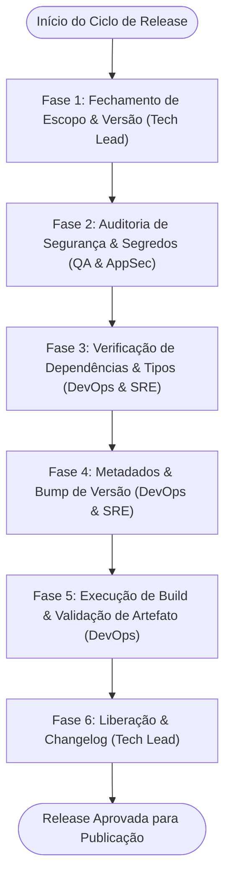

# 🚀 Workflow: Preparação & Homologação de Release (Release Prep)

> **Identificador:** `release-prep.md`  
> **Objetivo:** Garantir que todo lançamento do BeatSync (seja para Web Preview, Google Play Store ou Apple App Store via EAS) cumpra os mais altos padrões de segurança, estabilidade de build, auditoria de segredos e conformidade de dependências.

---

## Visão Geral do Fluxo



---

## Detalhamento das Fases

### Fase 1: Fechamento de Escopo & Versão
- **Agente Responsável:** [01-tech-lead-orchestrator.md](file:///d:/CASSIO/git/beatsync/.agents/personas/01-tech-lead-orchestrator.md)
- **Ações:**
  1. Define o número de versão com base no SemVer (MAJOR.MINOR.PATCH).
  2. Cria a branch de release: `release/vX.Y.Z` a partir da branch principal.
  3. Congela o escopo: nenhum novo recurso ou refatoração entra nesta janela.
- **Handoff Gate para Fase 2:** Branch de release ativa e congelada.

---

### Fase 2: Auditoria de Segurança & Segredos
- **Agente Responsável:** [06-qa-security-engineer.md](file:///d:/CASSIO/git/beatsync/.agents/personas/06-qa-security-engineer.md)
- **Checklist Inegociável de Segurança:**
  - [ ] **Zero Segredos em Código:** Nenhuma chave privada, token ou senha hardcoded no repositório.
  - [ ] **Limpeza de Logs:** Nenhum `console.log` de depuração ou dump de objetos sensíveis ativo em tempo de execução.
  - [ ] **Sanitização de Permissões:** O `app.json` requisita apenas as permissões estritamente necessárias para a operação do aplicativo.
  - [ ] **Integridade do AsyncStorage:** Migrações ou esquemas de dados salvos de versões anteriores continuam compatíveis sem corrupção.
- **Handoff Gate para Fase 3:** Checklist de segurança 100% aprovado.

---

### Fase 3: Verificação de Dependências & Integridade de Tipos
- **Agente Responsável:** [07-devops-sre.md](file:///d:/CASSIO/git/beatsync/.agents/personas/07-devops-sre.md)
- **Ações:**
  1. Executa verificação de tipos completa:
     ```bash
     npx tsc --noEmit
     ```
  2. Executa diagnóstico do ecossistema Expo:
     ```bash
     npx expo-doctor
     ```
  3. Testa compilação da exportação web para garantir integridade do Metro Bundler:
     ```bash
     npm run build:web
     ```
- **Handoff Gate para Fase 4:** Todos os comandos rodam com código de saída 0 (zero erros).

---

### Fase 4: Metadados & Bump de Versão
- **Agente Responsável:** [07-devops-sre.md](file:///d:/CASSIO/git/beatsync/.agents/personas/07-devops-sre.md)
- **Ações:**
  1. Atualiza `version` no `package.json`.
  2. Atualiza os identificadores nativos em `app.json`:
     - iOS: incrementa `buildNumber`.
     - Android: incrementa `versionCode`.
  3. Registra os commits de bump seguindo Conventional Commits (`chore(release): bump to vX.Y.Z`).
- **Handoff Gate para Fase 5:** Arquivos de manifesto e pacotes atualizados e sincronizados.

---

### Fase 5: Execução de Build & Validação de Artefato
- **Agente Responsável:** [07-devops-sre.md](file:///d:/CASSIO/git/beatsync/.agents/personas/07-devops-sre.md)
- **Ações:**
  1. Dispara o build móvel no EAS ou compila o pacote de preview:
     ```bash
     eas build --platform all --profile production
     ```
  2. Valida se o artefato gerado (.ipa / .aab ou bundle web) iniciou corretamente sem crashes imediatos na inicialização (*smoke test*).
- **Handoff Gate para Fase 6:** Binário ou build gerado e testado.

---

### Fase 6: Liberação & Changelog Oficial
- **Agente Responsável:** [01-tech-lead-orchestrator.md](file:///d:/CASSIO/git/beatsync/.agents/personas/01-tech-lead-orchestrator.md)
- **Ações:**
  1. Redige o Release Notes / Changelog oficial destacando:
     - 🚀 Novas Funcionalidades
     - 🐛 Correções de Bugs
     - ⚡ Melhorias de Performance & Estabilidade
  2. Atualiza a versão e o histórico no [PROJECT_CONTEXT.md](file:///d:/CASSIO/git/beatsync/.agents/PROJECT_CONTEXT.md).
  3. Autoriza a mesclagem da branch de release e a aplicação da tag Git (`vX.Y.Z`).
